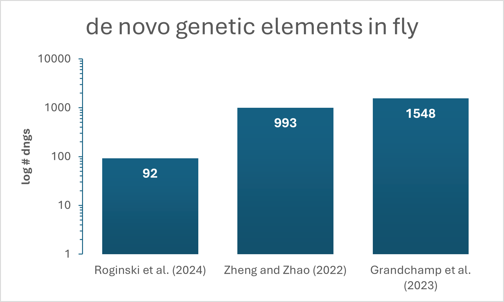

Case Study: Fruit Fly (Drosophila melanogaster)
================================================

The number of detected dngs between the three selected studies on fly dngs (see Fig. 2) vary greatly. 
This discrepancy most likely stems from different methodologies applied, used databases and selected thresholds. 
To better assess the similarities and differences, we annotated the studies with our 
DENOFO toolkit and applied the pairwise comparator to each study combination (see Tab. 2).

Figure 2: Number of dngs detected in Drosophila melanogaster by three different studies (Roginski et al. 2024; Zheng & Zhao 2022; Grandchamp et al. 2023).

.. rubric:: Table 2: Similarities and differences between studies on fly dngs

.. raw:: html

   
   
   <table border="1" class="docutils">
   <colgroup>
   <col width="25%" />
   <col width="25%" />
   <col width="25%" />
   <col width="25%" />
   </colgroup>
   <thead valign="bottom">
   <tr><th class="head">Feature</th>
   <th class="head">Roginski et al. (2024)</th>
   <th class="head">Zheng &amp; Zhao (2022)</th>
   <th class="head">Grandchamp et al. (2023)</th>
   </tr>
   </thead>
   <tbody valign="top">
   <tr><td>Input</td>
   <td>genome</td>
   <td class="highlight-match">transcriptome</td>
   <td class="highlight-match">transcriptome</td>
   </tr>
   <tr><td>ORF location</td>
   <td></td>
   <td class="highlight-match">intergenic, antisense, intronic, overlapping</td>
   <td class="highlight-match">intergenic, antisense, intronic, overlapping</td>
   </tr>
   <tr><td>Specificity</td>
   <td class="highlight-match">lineage</td>
   <td class="highlight-match">lineage</td>
   <td>species</td>
   </tr>
   <tr><td>Homology filter</td>
   <td class="highlight-match">protein sequences</td>
   <td class="highlight-match">protein sequences</td>
   <td class="highlight-match">protein sequences</td>
   </tr>
   <tr><td>E-value</td>
   <td>0.0001</td>
   <td></td>
   <td>0.1</td>
   </tr>
   <tr><td>Database</td>
   <td>NCBI nr</td>
   <td>custom</td>
   <td>custom</td>
   </tr>
   <tr><td>Synteny</td>
   <td class="highlight-match">gene anchors</td>
   <td></td>
   <td class="highlight-match">gene anchors</td>
   </tr>
   <tr><td>Translational evidence</td>
   <td></td>
   <td>ribosome profiling, MS</td>
   <td></td>
   </tr>
   <tr><td>Selection</td>
   <td>codeml</td>
   <td></td>
   <td>dN/dS</td>
   </tr>
   <tr><td>Enabling mutations</td>
   <td></td>
   <td></td>
   <td>yes</td>
   </tr>
   </tbody>
   </table>

Roginski et al. (2024) and Grandchamp et al. (2023), the two studies with the biggest difference in number of detected dngs in flies, 
share only two methodological similarities in total across all reported standardised features. 
These similarities are the use of protein sequences for homology filtering and using gene anchors for synteny detection 
(see :download:`Fly_similarities_Roginski-2024_vs_Grandchamp-2023.txt <_static/case_study_fly_dngs/Fly_similarities_Roginski-2024_vs_Grandchamp-2023.txt>` in Supplementary Output Files below, representing the output of the denofo-comparator).
The two studies that are closest by number of detected dngs, Zheng & Zhao (2022) and Grandchamp et al. (2023), 
overlap in type of input data (transcriptome), which transcripts are considered (intergenic, antisense, intronic overlapping), 
protein sequences for homology filtering. 
Hence, the discrepancy in the number of detected dngs, must stem from the data analysis like the use of ribosome profiling and mass spectrometry (MS) 
for translational evidence in Zheng & Zhao (2022).

It is both difficult and time consuming to compare and assess the datasets and methodologies of published data on detected dgns manually. 
The standardised annotation with the developed DENOFO toolkit provides an overview of overlaps between datasets in a convenient way. 
Next to such surprising similarities in methodology, DENOFO also allows to compare the differences between the studies, 
which can help us to identified why studies using the same input data come to different conclusions. 
To analyse the differences in more detail, we focus here on the two studies by Roginski et al. (2024) and Grandchamp et al. (2023) 
that are farthest apart regarding the number of detected dngs 
(see :download:`Fly_differences_Roginski-2024_vs_Grandchamp-2023.txt <_static/case_study_fly_dngs/Fly_differences_Roginski-2024_vs_Grandchamp-2023.txt>` in Supplementary Output Files below, representing the output of the denofo-comparator).

We identify differences in the input data, which is a transcriptome in Grandchamp et al. (2023), 
but an annotated genome in Roginski et al. (2024). 
While Roginski et al. identify lineage-specific dngs, Grandchamp et al.’s are strictly species-specific. 
This alone can explain already a large difference in number of detected dngs. 
Also, selected thresholds are easy to identify here as a source of differences in number of detected dngs: 
Roginski et al. selected a way stricter e-value threshold of 0.0001 for homology filtering than Grandchamp et al. with 0.1 as an e-value threshold. 
The stricter e-value threshold will result in a lower number of dngs filtered out, which contrasts with the much lower number of identified dngs. 
Homology filtering was based on a custom database of Drosophila and Dipteran proteomes in Grandchamp et al., 
while Roginski et al. Used the NCBI nr database. 
The database of more closely related species in Grandchamp et al. can have led to the higher amount of dngs, 
which were filtered out in Roginski et al. due to matches in more distantly related species. 
Apart from only methodological differences leading to discrepancies in numbers of identified dngs, 
the annotation and comparison through DENOFO allows to extract useful information contained in the studies, 
which might be relevant for readers. 
As an example, we can see in the differences from the denofo-comparator output that Grandchamp et al. report information about enabling mutations, 
which is missing in Roginski et al. 
However, Roginski et al. report additional evolutionary information in the form of selection studied through codeml, 
while Grandchamp et al. report selection information based on dN/dS values.

Conclusions
-----------

The numbers of detected dngs between the selected studies on both, human and fly dngs differ by orders of magnitude. 
This large discrepancy might stem from different applied methodologies, databases and selected thresholds. 
Yet, it can be difficult to assess and compare which exact methods were applied and where they differ. 
With the information provided through the standardised annotation format and analysed and processed for easy comparison by the DENOFO tools, 
we can gain insights into the specifics of differences and similarities between these studies. 
Additionally, we learn about the impact of specific methodological differences the more studies are annotated this way and can be compared and analysed in a feasible way.

Supplementary Output Files (Fruit Fly)
--------------------------------------

Study annotation files in dngf format:

- :download:`Fly_Roginski_2024.dngf <_static/case_study_fly_dngs/Fly_Roginski_2024.dngf>`
- :download:`Fly_Grandchamp_2023.dngf <_static/case_study_fly_dngs/Fly_Grandchamp_2023.dngf>`
- :download:`Fly_Zheng_and_Zhao_2022.dngf <_static/case_study_fly_dngs/Fly_Zheng_and_Zhao_2022.dngf>`

Pairwise similarities and differences produced by the DENOFO comparator are available as text files:

- :download:`Fly_similarities_Roginski-2024_vs_Grandchamp-2023.txt <_static/case_study_fly_dngs/Fly_similarities_Roginski-2024_vs_Grandchamp-2023.txt>`
- :download:`Fly_similarities_Zheng-and-Zhao-2022_vs_Grandchamp-2023.txt <_static/case_study_fly_dngs/Fly_similarities_Zheng-and-Zhao-2022_vs_Grandchamp-2023.txt>`
- :download:`Fly_similarities_Zheng-and-Zhao-2022_vs_Roginski-2024.txt <_static/case_study_fly_dngs/Fly_similarities_Zheng-and-Zhao-2022_vs_Roginski-2024.txt>`
- :download:`Fly_differences_Roginski-2024_vs_Grandchamp-2023.txt <_static/case_study_fly_dngs/Fly_differences_Roginski-2024_vs_Grandchamp-2023.txt>`
- :download:`Fly_differences_Zheng-and-Zhao-2022_vs_Grandchamp-2023.txt <_static/case_study_fly_dngs/Fly_differences_Zheng-and-Zhao-2022_vs_Grandchamp-2023.txt>`
- :download:`Fly_differences_Zheng-and-Zhao-2022_vs_Roginski-2024.txt <_static/case_study_fly_dngs/Fly_differences_Zheng-and-Zhao-2022_vs_Roginski-2024.txt>`

References
----------

- Roginski P, Grandchamp A, Quignot C, Lopes A. De Novo Emerged Gene Search in Eukaryotes with DENSE. Genome Biology and Evolution. 2024 Aug;16(8):evae159.
- Grandchamp A, Kühl L, Lebherz M, Brüggemann K, Parsch J, Bornberg-Bauer E. Population genomics reveals mechanisms and dynamics of de novo expressed open reading frame emergence in Drosophila melanogaster. Genome Research. 2023 Jun 1;33(6):872–90.
- Zheng EB, Zhao L. Protein evidence of unannotated ORFs in Drosophila reveals diversity in the evolution and properties of young proteins. eLife. 2022 Sep 30;11:e78772.