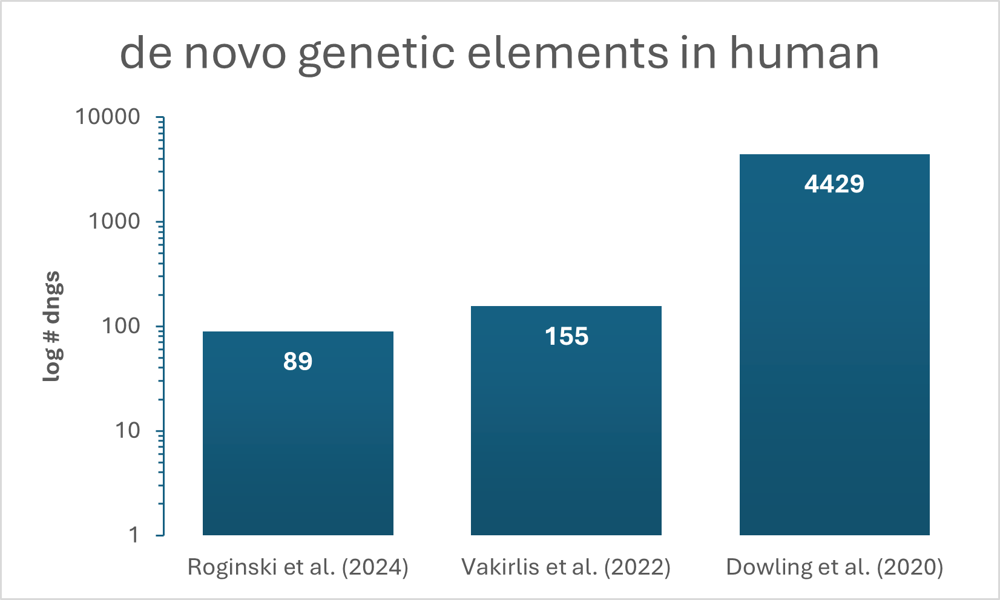

Case Study: Human (Homo sapiens)
=================================

The amount of detected dngs between the three selected studies for human dngs varies by orders of magnitude (see Figure 1). 
These differences in reported numbers of dngs is likely due to different methods, databases and thresholds used. 
To assess those discrepancies, we annotated the studies with our DENOFO toolkit and applied the pairwise comparator to each study combination (see Table 1).

Figure 1: Number of dngs detected in Homo sapiens by three different studies (Roginski et al. 2024; Vakirlis et al. 2022; Dowling et al. 2020).

.. rubric:: Table 1: Similarities and differences between studies on human dngs

.. raw:: html

   
   
   <table border="1" class="docutils">
   <colgroup>
   <col width="25%" />
   <col width="25%" />
   <col width="25%" />
   <col width="25%" />
   </colgroup>
   <thead valign="bottom">
   <tr><th class="head">Feature</th>
   <th class="head">Roginski et al. (2024)</th>
   <th class="head">Vakirlis et al. (2022)</th>
   <th class="head">Dowling et al. (2020)</th>
   </tr>
   </thead>
   <tbody valign="top">
   <tr><td>Input</td>
   <td>genome</td>
   <td class="highlight-match">transcriptome</td>
   <td class="highlight-match">transcriptome</td>
   </tr>
   <tr><td>ORF choice</td>
   <td></td>
   <td>custom</td>
   <td>longest</td>
   </tr>
   <tr><td>Specificity</td>
   <td class="highlight-match">lineage</td>
   <td class="highlight-match">lineage</td>
   <td>species</td>
   </tr>
   <tr><td>Homology filter</td>
   <td class="highlight-match">protein sequences</td>
   <td class="highlight-match">protein sequences</td>
   <td class="highlight-match">protein sequences</td>
   </tr>
   <tr><td>E-value</td>
   <td class="highlight-match">0.0001</td>
   <td class="highlight-match">0.0001</td>
   <td>0.001</td>
   </tr>
   <tr><td>Database</td>
   <td>NCBI nr</td>
   <td>RefSeq</td>
   <td>custom</td>
   </tr>
   <tr><td>Synteny</td>
   <td>gene anchors</td>
   <td>whole genome alignment</td>
   <td></td>
   </tr>
   <tr><td>Translational evidence</td>
   <td></td>
   <td class="highlight-match">ribosome profiling</td>
   <td class="highlight-match">ribosome profiling</td>
   </tr>
   <tr><td>Selection</td>
   <td class="highlight-match">codeml</td>
   <td class="highlight-match">codeml</td>
   <td></td>
   </tr>
   </tbody>
   </table>

The two studies with the biggest difference in number of detected dngs, Roginski et al. (2024) and Dowling et al. (2020), 
share only one methodological overlap in total across all reported standardised features. 
The studies only overlap in their use of protein sequences for homology filtering 
(see :download:`Human_similarities_Dowling-2020_vs_Roginski-2024.txt <_static/case_study_human_dngs/Human_similarities_Dowling-2020_vs_Roginski-2024.txt>` in Supplementary Output Files below, representing the output of the denofo-comparator).

The two studies that are closest by number of detected dngs, Roginski et al. 2024 and Vakirlis et al. 2022, overlap in two annotations. 
Next to the already above-mentioned use of protein sequences for homology filtering, it is the reporting of lineage-specific dngs (in contrast to species-specific or population-specific ones). 
Although the studies by Vakirlis et al. and Dowling et al. show a large discrepancy in number of detected dngs (155 vs. 4429), 
their methodologies overlap, such as the used input data being in both cases the human transcriptome (in contrast to the genome) 
and the application of ribosome profiling for evidence of translation.

The only two overlaps in methodology between these studies, could already explain the discrepancy in the number of detected dngs. 
However, it becomes apparent, that even if the same type of input data (transcriptome) and the same method for translational evidence (ribosome profiling) were used, 
the number of detected dngs in humans still differs by orders of magnitude between those studies.

Dowling et al. (2020) and Roginski et al. (2024) are farthest apart regarding the number of detected dngs 
(see :download:`Human_differences_Dowling-2020_vs_Roginski-2024.txt <_static/case_study_human_dngs/Human_differences_Dowling-2020_vs_Roginski-2024.txt>` in Supplementary Output Files below, representing the output of the denofo-comparator).
The most apparent difference is the used input data, which is a human transcriptome in Dowling et al. (2020), 
but an annotated genome in Roginski et al. (2024). 
While Roginski et al. (2024) identify lineage-specific dngs, Dowling et al. focuses on strictly species-specific genes, leading to a difference in number of detected dngs.

Also, selected thresholds are easy to identify here as a source of differences in number of detected dngs: 
Roginski et al. selected a way stricter e-value threshold of 0.0001 for homology filtering than Dowling et al. with 0.001 as an e-value threshold. 
The stricter e-value threshold results in a lower number of considered dngs, which fits to the much lower number of identified dngs.

Apart from only methodological differences leading to discrepancies in numbers of identified dngs, 
the annotation and comparison through DENOFO allows to extract useful information contained in the studies, which might be relevant for readers. 
As an example, we can see in the differences from the denofo-comparator output that Roginski et al. report additional evolutionary information in the form of selection studied through codeml.

Conclusions
------------
The numbers of detected dngs between the selected studies on both, human and fly dngs (see Fig. 1-2, note logarithmic scale), differ by orders of magnitude. 
This large discrepancy might stem from different applied methodologies, databases and selected thresholds. 
Yet, it can be difficult to assess and compare which exact methods were applied and where they differ. 
With the information provided through the standardised annotation format and analysed and processed for easy comparison by the DENOFO tools, 
we can gain insights into the specifics of differences and similarities between these studies. 
Additionally, we learn about the impact of specific methodological differences the more studies are annotated this way and can be compared and analysed in a feasible way.

Supplementary Output Files (Human)
----------------------------------------

Study annotation files in dngf format:

- :download:`Human_Dowling_2020.dngf <_static/case_study_human_dngs/Human_Dowling_2020.dngf>`
- :download:`Human_Roginski_2024.dngf <_static/case_study_human_dngs/Human_Roginski_2024.dngf>`
- :download:`Human_Vakirlis_2022.dngf <_static/case_study_human_dngs/Human_Vakirlis_2022.dngf>`

Pairwise similarities and differences produced by the DENOFO comparator are available as text files:

- :download:`Human_similarities_Dowling-2020_vs_Roginski-2024.txt <_static/case_study_human_dngs/Human_similarities_Dowling-2020_vs_Roginski-2024.txt>`
- :download:`Human_similarities_Vakirlis-2022_vs_Dowling-2020.txt <_static/case_study_human_dngs/Human_similarities_Vakirlis-2022_vs_Dowling-2020.txt>`
- :download:`Human_similarities_Vakirlis-2022_vs_Roginski-2024.txt <_static/case_study_human_dngs/Human_similarities_Vakirlis-2022_vs_Roginski-2024.txt>`
- :download:`Human_differences_Dowling-2020_vs_Roginski-2024.txt <_static/case_study_human_dngs/Human_differences_Dowling-2020_vs_Roginski-2024.txt>`
- :download:`Human_differences_Vakirlis-2022_vs_Dowling-2020.txt <_static/case_study_human_dngs/Human_differences_Vakirlis-2022_vs_Dowling-2020.txt>`
- :download:`Human_differences_Vakirlis-2022_vs_Roginski-2024.txt <_static/case_study_human_dngs/Human_differences_Vakirlis-2022_vs_Roginski-2024.txt>`

Additional file:

- :download:`fasta_annotated_Dowling_2020.fa <_static/case_study_human_dngs/fasta_annotated_Dowling_2020.fa>`

References
----------

- Vakirlis N, Vance Z, Duggan KM, McLysaght A. De novo birth of functional microproteins in the human lineage. Cell Reports. 2022 Dec 20;41(12).
- Dowling D, Schmitz JF, Bornberg-Bauer E. Stochastic gain and loss of novel transcribed open reading frames in the human lineage. Genome Biology and Evolution. 2020 Nov;12(11):2183–95.
- Roginski P, Grandchamp A, Quignot C, Lopes A. De Novo Emerged Gene Search in Eukaryotes with DENSE. Genome Biology and Evolution. 2024 Aug;16(8):evae159.