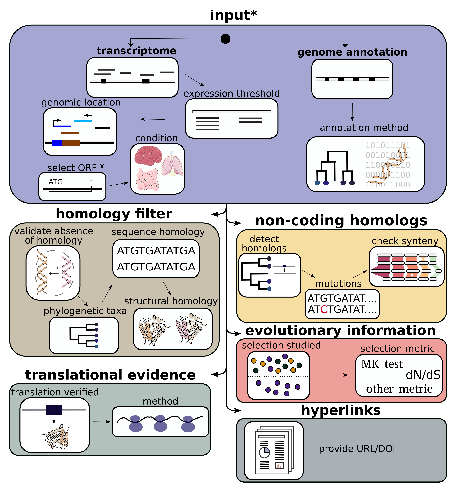

Questionnaire Overview
======================

.. raw:: html

   

This page provides a comprehensive overview of all questions in the DENOFO questionnaire, 
organized in a table format showing the relationship between questions, their corresponding 
field names in the data model, and the expected data types.

Questionnaire Structure
-----------------------

The questionnaire is organized into sections covering different aspects of de novo gene annotation:

1. `Input Data`_ (Section 1) - Questions about the source data used for gene detection
2. `Homology Filter`_ (Section 2) - Questions about homology validation methods  
3. `Non-coding Homologs`_ (Section 3) - Questions about non-genic homologous sequences
4. `Evolutionary Information`_ (Section 4) - Questions about selection pressure analysis
5. `Translational Evidence`_ (Section 5) - Questions about translation verification
6. `Hyperlinks`_ (Section 6) - Questions about study references

   **Figure 1:** Overview of the DENOFO questionnaire structure showing the six main sections and their color coding used throughout this documentation.

Complete Question Reference
---------------------------

Input Data
^^^^^^^^^^

.. raw:: html

   

   
<strong>Section 1: Input Data</strong> - Questions about the source data used for gene detection

   

.. list-table:: Input Data Questions
   :widths: 50 25 25
   :header-rows: 1
   :class: input-data-table

   * - Question
     - Field Name
     - Type
   * - Did you detect your candidate de novo genes from a:
     - inputData
     - list[:class:`~denofo.choices.InputDataChoices`]
   * - Please choose the genome annotation method:
     - annotGenomeChoice  
     - list[:class:`~denofo.choices.AnnotGenomeChoices`]
   * - Did you apply a TPM threshold used as a minimum level of transcript expression? (yes/no)
     - inputTranscriptome
     - bool
   * - Please provide the TPM threshold used as a minimum level of transcript expression:
     - expressionLevel
     - float | None
   * - Please indicate which transcripts were kept based on their overlap with the following genetic contexts:
     - transContextChoice
     - list[:class:`~denofo.choices.GeneticContextChoices`]
   * - Please provide your custom genetic context for your transcriptome data:
     - customGeneticContext
     - list[str] | None
   * - Please choose which ORFs in the transcripts were selected:
     - transORFChoice
     - list[:class:`~denofo.choices.ORFChoices`]
   * - Please provide your custom ORF selection for your transcriptome data:
     - customORF
     - list[str] | None
   * - Do you want to add additional information about the transcriptome (e.g. tissue, cell type, ...)? (yes/no)
     - answerTranscriptomeInfo
     - bool
   * - Please provide the information about the transcriptome (e.g. tissue, cell type, ...):
     - transcriptomeInfo
     - str | None
   * - Please provide your custom input data for de novo gene detection:
     - customInputData
     - str | None

Homology Filter
^^^^^^^^^^^^^^^

.. raw:: html

   

   
<strong>Section 2: Homology Filter</strong> - Questions about homology validation methods

   

.. list-table:: Homology Filter Questions
   :widths: 50 25 25
   :header-rows: 1
   :class: homology-filter-table

   * - Question
     - Field Name
     - Type
   * - Did you validate absence of homology of your de novo genes? (yes/no)
     - homologyFilter
     - bool
   * - Do you know in which taxonomic group your de novo gene candidates emerged? (yes/no)
     - phylogeneticTaxa
     - bool
   * - Please choose the specificity for the taxonomic group where they emerged:
     - taxSpecificity
     - :class:`~denofo.choices.TaxSpecificityChoices`
   * - Please provide the taxonomic ID (name or number from NCBI Taxonomy DB) where they emerged:
     - taxID
     - str | int
   * - Please choose your sequence type(s) used for homology filtering:
     - seqType
     - list[:class:`~denofo.choices.SeqTypeChoices`]
   * - Please provide your custom sequence type(s) used for homology filtering:
     - customSeqType
     - list[str] | None
   * - Did you use structural similarity for homology filtering? (yes/no)
     - QStructuralSimilarity
     - bool
   * - Please provide the structural similarity search software/method used for homology filtering:
     - structuralSimilarity
     - str | None
   * - Please choose the metric used for homology filtering:
     - threshold
     - list[:class:`~denofo.choices.ThresholdChoices`]
   * - Please provide your custom metric for homology filtering:
     - customThreshold
     - list[str] | None
   * - Please provide the threshold value for your homology filtering based on {metric}:
     - thresholdValue
     - list[float]
   * - Please choose the database(s) used for homology filtering:
     - dataBase
     - list[:class:`~denofo.choices.HomologyDBChoices`]
   * - Please provide your custom database used for homology filtering:
     - customDB
     - list[str] | None

Non-coding Homologs
^^^^^^^^^^^^^^^^^^^

.. raw:: html

   

   
<strong>Section 3: Non-coding Homologs</strong> - Questions about non-genic homologous sequences

   

.. list-table:: Non-coding Homologs Questions
   :widths: 50 25 25
   :header-rows: 1
   :class: non-coding-homologs-table

   * - Question
     - Field Name
     - Type
   * - Did you detect non-genic homologous sequences in genomes from other taxonomic groups? (yes/no)
     - nonCodingHomologs  
     - bool
   * - Did you study conservation/mutations between de novo genes and homologous sequences?
     - enablingMutations
     - bool
   * - Did you check for synteny between de novo genes and their homologous sequences? (yes/no)
     - synteny
     - bool
   * - What was used to identify the syntenic region?:
     - anchors
     - list[:class:`~denofo.choices.AnchorChoices`]
   * - Please provide your custom anchor for synteny search:
     - customAnchor
     - list[str] | None
   * - Did you use a specific software for the synteny search? (yes/no)
     - answerSoftwareSyntenySearch
     - bool
   * - Please choose the software used for the synteny search:
     - softwareSyntenySearch
     - list[str] | None

Evolutionary Information
^^^^^^^^^^^^^^^^^^^^^^^^

.. raw:: html

   

   
<strong>Section 4: Evolutionary Information</strong> - Questions about selection pressure analysis

   

.. list-table:: Evolutionary Information Questions
   :widths: 50 25 25
   :header-rows: 1
   :class: evolutionary-information-table

   * - Question
     - Field Name
     - Type
   * - Did you study selection pressure of the de novo genes? (yes/no)
     - evolutionaryInformation
     - bool
   * - Please provide the metric or method used to identify selection pressure:
     - selection
     - str | None

Translational Evidence
^^^^^^^^^^^^^^^^^^^^^^

.. raw:: html

   

   
<strong>Section 5: Translational Evidence</strong> - Questions about translation verification

   

.. list-table:: Translational Evidence Questions
   :widths: 50 25 25
   :header-rows: 1
   :class: translational-evidence-table

   * - Question
     - Field Name
     - Type
   * - Did you verify the translation of the de novo genes? (yes/no)
     - translationalEvidence
     - bool
   * - Please choose the method used as evidence for translation:
     - translationEvidence
     - list[:class:`~denofo.choices.TranslationEvidenceChoices`] | None
   * - Please provide your custom method used as evidence for translation:
     - customTranslationEvidence
     - list[str] | None

Hyperlinks
^^^^^^^^^^

.. raw:: html

   

   
<strong>Section 6: Hyperlinks</strong> - Questions about study references

   

.. list-table:: Hyperlinks Questions
   :widths: 50 25 25
   :header-rows: 1
   :class: hyperlinks-table

   * - Question
     - Field Name
     - Type
   * - Do you want to provide a URL/doi to your study/detailed methods? (yes/no)
     - QstudyURL
     - bool
   * - Please provide the URL/doi to your study/detailed methods:
     - studyURL
     - list[str] | None

Data Types Reference
--------------------

**Choice Enumerations:**

* :class:`~denofo.choices.InputDataChoices`: annotated genome, transcriptome, custom choice
* :class:`~denofo.choices.AnnotGenomeChoices`: ab initio approach, homology-based approach, unknown  
* :class:`~denofo.choices.GeneticContextChoices`: intergenic, antisense, intronic, overlap gene, custom choice
* :class:`~denofo.choices.ORFChoices`: no ORF, all ORF, highest Kozac, longest ORF, start first ORF, long 5` 3` ORF, custom choice
* :class:`~denofo.choices.TaxSpecificityChoices`: tissue/condition-specific, species-specific, lineage-specific
* :class:`~denofo.choices.SeqTypeChoices`: protein sequences, DNA, 6-frame translation, RNA, ncRNAs, transposable elements, custom choice  
* :class:`~denofo.choices.ThresholdChoices`: e-value, coverage [%], custom choice
* :class:`~denofo.choices.HomologyDBChoices`: NCBI NR, RefSeq, UniProtKB/TrEMBL, UniProtKB/Swiss-Prot, ENA (by EMBL-EBI), Ensembl, InterPro, custom choice
* :class:`~denofo.choices.AnchorChoices`: gene anchors, genome alignment, custom choice
* :class:`~denofo.choices.TranslationEvidenceChoices`: mass spectrometry, ribosome profiling, periodicity, custom choice

**Basic Types:**

* **str**: String/text value
* **int**: Integer number
* **float**: Decimal number  
* **bool**: Boolean (True/False)
* **list[Type]**: List containing elements of the specified type
* **Type | None**: Optional field that can be the specified type or None/empty

Notes
-----

- Questions are presented in logical order following the questionnaire flow
- Some questions are conditional and may not appear based on previous answers
- Fields marked with "| None" are optional and may be empty
- Custom choice options allow users to provide their own values when predefined choices don't apply
- The questionnaire uses a question stack system that allows users to navigate back to previous questions
